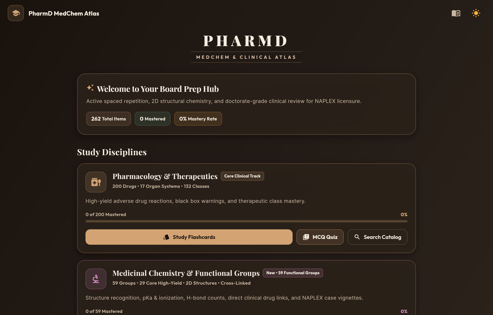
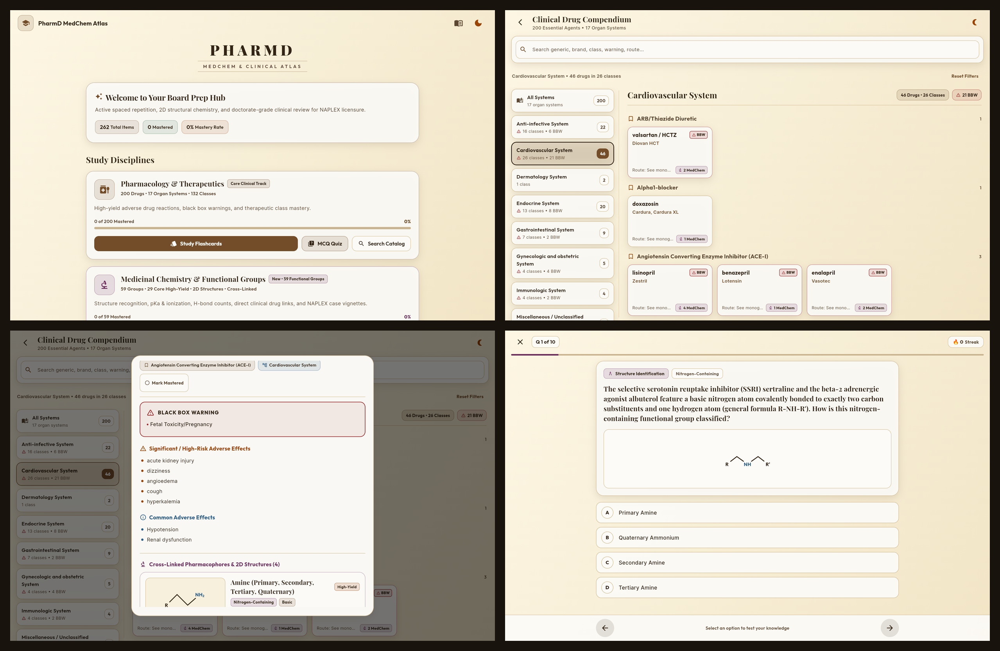

# PharmD MedChem Atlas

**Procedural 2D IUPAC Skeletal Rendering · Relational SAR/ADME Knowledge Graph · Clinical Pharmacology Assessment Suite**

 

> [!IMPORTANT]
> **Public Engineering Showcase & Issue Tracker:** This repository hosts architectural documentation, high-resolution visual demonstrations, and structured access/feedback tracking for **PharmD MedChem Atlas**. Executable source code, procedural vector geometry engines, and curated pharmacological/medicinal-chemistry datasets are maintained in a separate private repository.
>
> * **[Request Private Beta Access](../../issues/new?template=access_request.yml)** — Request collaborator evaluation access or private build previews.
> * **[Submit Feedback or Bug Report](../../issues/new?template=feedback_or_bug.yml)** — Share feature suggestions, usability feedback, or clinical content notes.

---

## Visual Architecture Overview (2x Retina)

*Clockwise from top-left: Light Sepia Parchment Editorial Hub · Split-Pane Cardiovascular Compendium (`300px` Organ System Sidebar & Class-Grouped Cards) · 2D Skeletal Structure Identification MCQ Engine · Cross-Linked Drug Monograph with FDA Black Box Warning Callout & Live 2D Pharmacophores.*

---

## Discipline & Feature Tour

| Track | Scope & Clinical Coverage | Interactive Capabilities |
| :--- | :--- | :--- |
| **Pharmacology & Therapeutics** | **200** essential pharmacologic agents across **17** organ systems and **132** therapeutic classes | Desktop split-pane organ-system compendium, class-grouped grids, FDA Black Box Warning callouts, **4-archetype clinical MCQ engine** (*Generic ↔ Brand*, *Drug → Class*, *BBW/ADR → Drug*), and persistent mastery tracking |
| **Medicinal Chemistry & Functional Groups** | **59** functional groups (including **29** core high-yield motifs) spanning hydrocarbons, oxygen/nitrogen scaffolds, sulfur/phosphorus oxoacids, and heterocycles | Zero-dependency procedural 2D IUPAC skeletal rendering, **4-archetype Practice & Timed Exam Simulator** (*2D Structure ID*, *Physicochemical/$\text{p}K_a$*, *Drug-Moiety Linkage*, *Clinical Case Vignettes*), 2-way 3D flashcards, and targeted remediation of missed groups |
| **Pharmaceutics & Biopharmaceutics** | Physical pharmacy foundations, dissolution kinetics, ionization equilibria, and chemical stability | Noyes-Whitney dissolution dynamics, Henderson-Hasselbalch pH-partition calculations, and zero-order vs. first-order degradation ($t_{90}$ shelf-life) cards with worked examples |

---

## Systems Engineering & Accessibility Highlights

### 1. Zero-Dependency Procedural 2D IUPAC Skeletal Renderer
* Rather than bundling hundreds of static bitmap images or invoking heavyweight native C++ bindings inside web assemblies, all 59 chemical functional groups are synthesized deterministically in pure client-side vector canvas geometry.
* Enforces standard medicinal chemistry conventions: $120^\circ$ $sp^2$/aromatic rings, $109.5^\circ$ tetrahedral projected zig-zags, strictly collinear $180^\circ$ $sp$ triple bonds, canonical fused 6-5 Kekulé bicyclic rings, and dual-mode CPK heteroatom inks calibrated for both **Light Parchment (`#FDF6E3`)** and **Dark Obsidian-Espresso (`#19130E`)**.

### 2. Bidirectional Cheminformatics ↔ Clinical Knowledge Graph
* Every functional group card captures $\text{p}K_a$ ranges, physiological ionization fractions at **blood pH 7.4**, **gastric pH 1–2**, and **duodenal pH 5.5–6.5**, formal charges, $\log P$ solubility impact, H-bond donor/acceptor counts, and Phase I/II CYP450 metabolic liabilities.
* Clinical drug monographs dynamically cross-link back to every constituent pharmacophore, rendering live 2D skeletal structure plates right inside the drug's safety and adverse-effect monograph—while excluding parent/subtype overlaps (e.g., generic amines vs. primary/secondary/tertiary amines) during MCQ distractor synthesis.

### 3. Academic Sepia Design System & WCAG 2.1 AA/AAA Accessibility
* **Dual-Mode Sepia Palette:** Classic ivory textbook parchment (`#FDF6E3` / `#FCFBF7`) paired with deep obsidian-espresso (`#19130E` / `#2B221A`) and a three-tier typographic hierarchy (`Playfair Display` academic serif headings, `Outfit` geometric labels, and `Inter` body text).
* **Full Keyboard & Assistive Support:** Route- and focus-guarded keyboard shortcuts (`1–4` answer selection, `Enter`/`Arrows` navigation, `F` exam flagging, `Space` flashcard flip), high-contrast `2px` focus rings, `>= 48x48` logical pixel tap targets across buttons/chips/navigator tiles, and explicit `Semantics` descriptions for every 2D chemical diagram.

---

## Quality & Verification Benchmarks

| Metric | Verified Result |
| :--- | :--- |
| **2D Skeletal Coverage** | **59 / 59** functional groups procedurally rendered without fallback |
| **Clinical & Curated Question Coverage** | **200** drug monographs (**17** systems, **132** classes) + **44** curated case vignettes + procedural question synthesis |
| **Automated Test & WCAG Checks** | **37 / 37** unit, widget, rendering, and Light/Dark Sepia `textContrastGuideline` / `androidTapTargetGuideline` / `labeledTapTargetGuideline` tests passing |
| **Static Analysis & Release Footprint** | **0** analyzer issues; **98.8%** icon font tree-shaking reduction in release Web compilation |

---

## Requesting Access or Sharing Feedback

Interested in testing **PharmD MedChem Atlas**, collaborating on medicinal chemistry content, or evaluating the engineering architecture?
* **[Open a Private Beta Access Request](../../issues/new?template=access_request.yml)**
* **[Submit Feedback or Report a Bug](../../issues/new?template=feedback_or_bug.yml)**

---

## Disclaimer & License

*Disclaimer: PharmD MedChem Atlas is an independent educational study and cheminformatics visualization project. It is not affiliated with any pharmacy licensing board or institution and does not constitute clinical decision support or medical advice.*

Copyright &copy; 2026 **PNWcoastie**. All Rights Reserved. See [LICENSE](LICENSE) for showcase and evaluation terms.
